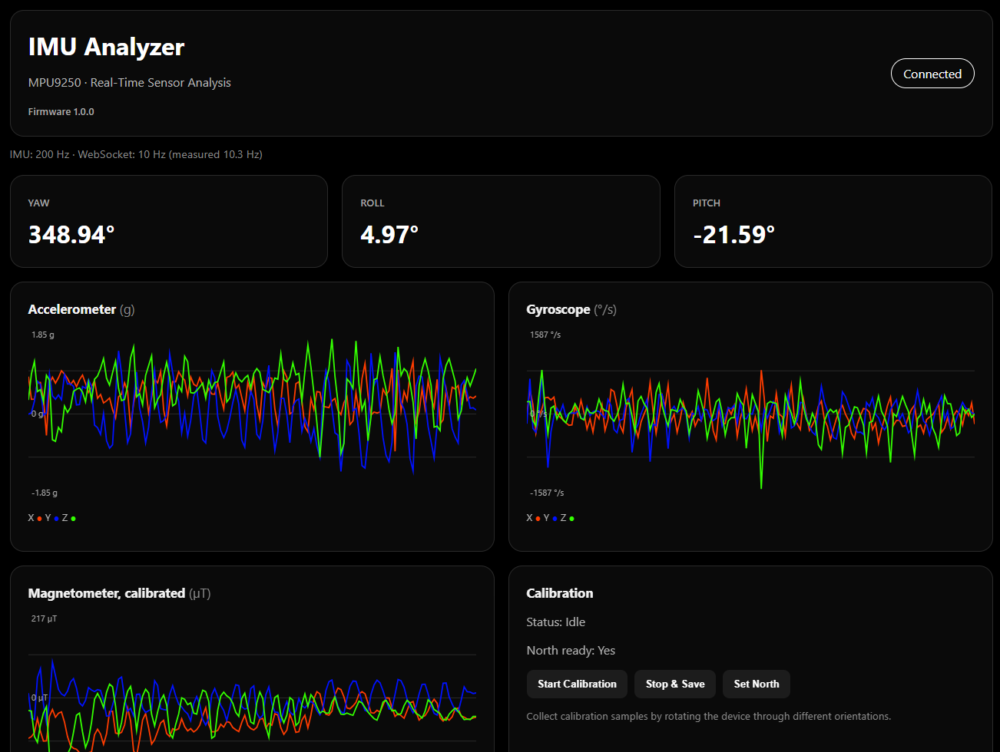
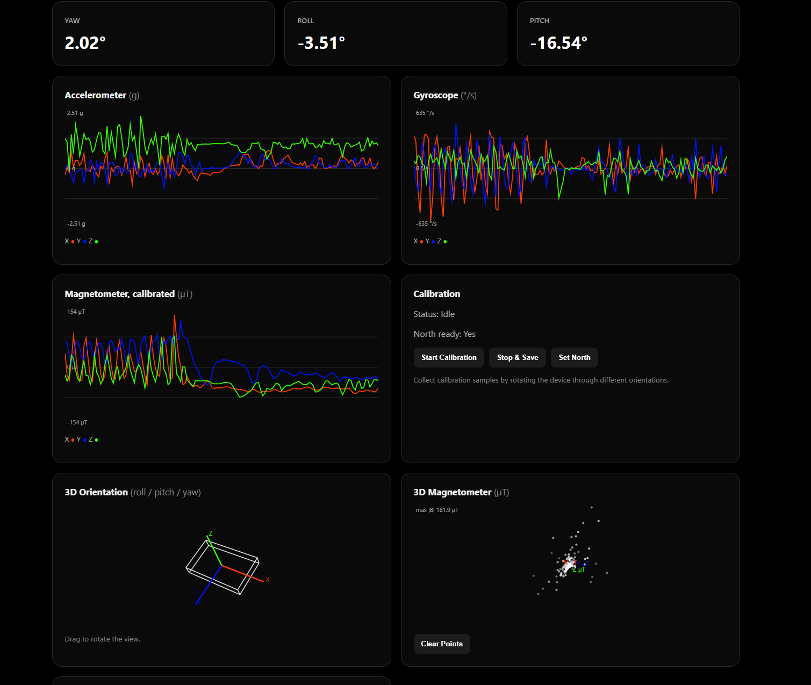
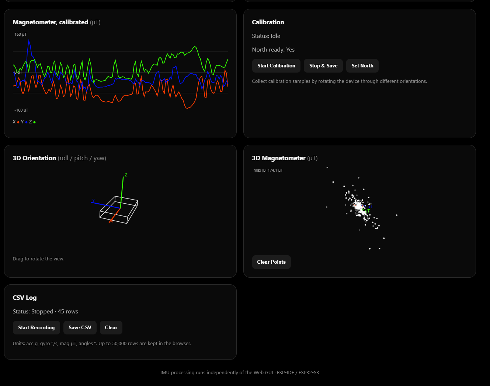
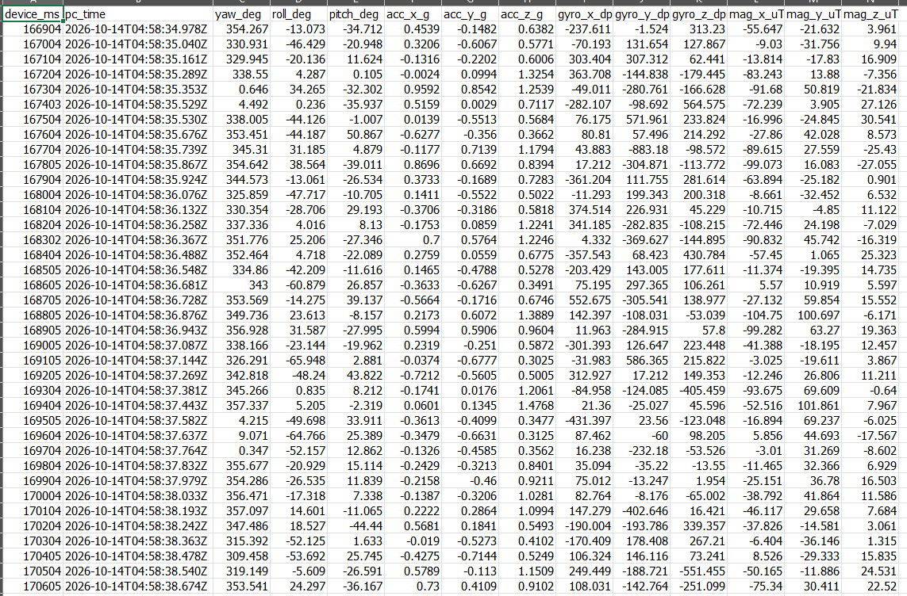
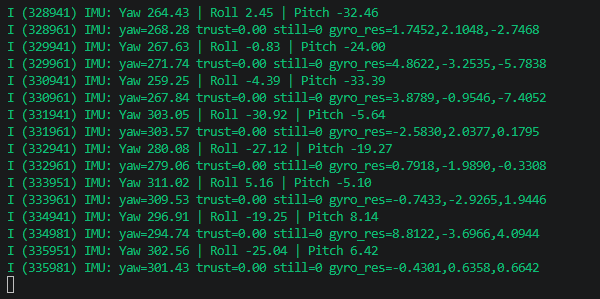
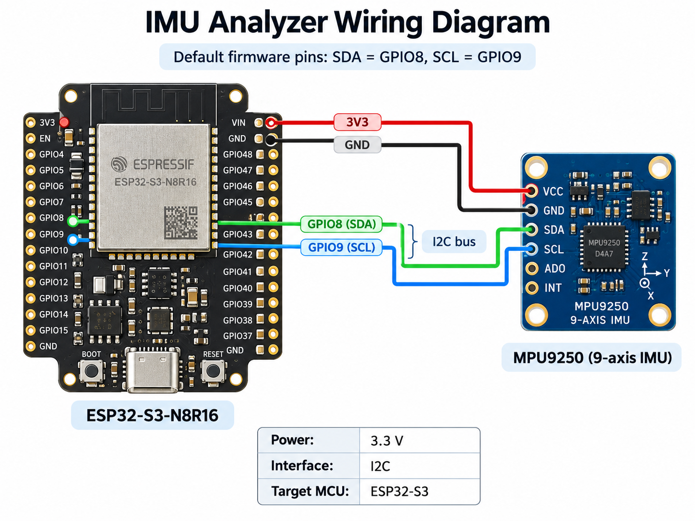

# 🧭 IMU Analyzer
### ESP32-S3 + MPU9250 | Real-Time IMU Monitoring, Sensor Fusion & Wi-Fi Dashboard
*(Dual Language — English / ภาษาไทย)*

IMU Analyzer is an ESP-IDF-based embedded measurement project that acquires 9-axis motion data from an MPU9250 (with AK8963 magnetometer), processes orientation on the microcontroller, and serves a browser-based dashboard over Wi-Fi. The web interface provides live sensor charts, orientation and magnetic-field visualizations, interactive calibration, and CSV recording.

The project uses **C for firmware** and **modular TypeScript, HTML and CSS for the web interface**. The browser is optional to the IMU acquisition and processing loop; it consumes published measurements rather than controlling the sensor sampling cadence.

**ภาพรวม:** IMU Analyzer เป็นโปรเจกต์ Embedded Measurement ที่ใช้ ESP32-S3 และ MPU9250/AK8963 อ่านข้อมูลการเคลื่อนไหว 9 แกน ประมวลผลมุมด้วย Sensor Fusion และแสดงผลผ่าน Web Dashboard บน Wi-Fi โดยใช้ ESP-IDF และ TypeScript ระบบอ่านและประมวลผล IMU ทำงานได้โดยไม่จำเป็นต้องเปิด Web GUI

> **Project status / สถานะ:** Hardware and Web GUI tested by the author / ผู้พัฒนาได้ทดสอบฮาร์ดแวร์และ Web GUI แล้ว รายละเอียด Configuration อ้างอิงจาก Source Snapshot ที่ใช้จัดทำเอกสารนี้

---

## 🧩 Version / เวอร์ชัน

| Version | Description / รายละเอียด |
| --- | --- |
| **v1.0.0** | Initial portfolio release documentation: 9-axis IMU acquisition, EKF orientation, magnetometer calibration, Wi-Fi dashboard, 2D/3D visualization, and browser-side CSV logging / เอกสารเวอร์ชันเริ่มต้นสำหรับแสดงผลงาน |

*The version above labels this README release; verify that firmware versioning uses the same tag before publishing.*

---

## 📘 Overview / ภาพรวม

- **Embedded-first:** Acquisition and sensor fusion run on the ESP32-S3 independently of the browser. / งานอ่านและประมวลผลเซนเซอร์อยู่บน MCU
- **Local visualization:** ESP32-S3 serves HTML/CSS/TypeScript assets via HTTP and transmits measurements by WebSocket. / แสดงข้อมูลผ่านเว็บบน Wi-Fi โดยไม่ต้องต่ออินเทอร์เน็ต
- **Reusable architecture:** Components are separated into IMU driver, I²C, Wi-Fi and system information. / แบ่ง Component ชัดเจนเพื่อบำรุงรักษาและนำกลับไปใช้ใหม่

---

## 🖥️ Web Dashboard / หน้าจอแสดงผล

The IMU Analyzer includes a Wi-Fi web dashboard for real-time MPU9250 monitoring, sensor visualization, calibration control, and CSV logging.

Dashboard แสดงค่าจาก Accelerometer, Gyroscope และ Magnetometer พร้อม Orientation, 3D Visualization และการบันทึก CSV ผ่าน Browser

<p align="center">
  
</p>

<p align="center">
  Real-time MPU9250 monitoring, calibration, 3D orientation visualization, and CSV logging over Wi-Fi.
</p>

### Dashboard Overview / ภาพรวม Dashboard

The screenshots below show live 9-axis sensor graphs, orientation estimation, calibration controls, and 3D visualizations.







### CSV Logging / บันทึกข้อมูล CSV



## 🖥️ ESP-IDF Serial Monitor / บันทึกการทำงาน

The firmware also provides real-time serial output for debugging and orientation monitoring. / Firmware แสดงค่ามุมและข้อมูลวินิจฉัยผ่าน ESP-IDF Serial Monitor เพื่อใช้ทดสอบและ Debug



## 🔌 Hardware Wiring / แผนภาพการต่อวงจร

The MPU9250 is connected to the ESP32-S3 through the I²C interface. / เชื่อม MPU9250 กับ ESP32-S3 ผ่าน I²C โปรดตรวจสอบชื่อขาของบอร์ดจริงก่อนจ่ายไฟ เพราะตำแหน่งขาของแต่ละรุ่นอาจแตกต่างกัน



## 🧰 Hardware / ฮาร์ดแวร์

| Component | Description |
| --- | --- |
| Controller | ESP32-S3 development board (used with an ESP32-S3-N8R16 board) |
| Sensor | MPU9250 module with AK8963 magnetometer |
| Connection | I²C, configured for 400 kHz |
| Power | Use supply and I/O voltages supported by your particular sensor breakout; ESP32-S3 GPIO is 3.3 V logic |
| User interface | A phone or computer with Wi-Fi and a modern browser |

### Default Pin Assignment / การกำหนดขา

Defined in [`main/pin_config.h`](main/pin_config.h):

| Signal | ESP32-S3 GPIO | Notes |
| --- | --- | --- |
| SDA | GPIO8 | I²C data |
| SCL | GPIO9 | I²C clock |
| I²C port | I²C0 | 400 kHz configuration |
| MPU9250 address | `0x69` | Defined in the sensor driver; confirm AD0/address wiring |
| AK8963 address | `0x0C` | Magnetometer |

Use suitable pull-up resistors on SDA/SCL if your module does not already provide them. Connect grounds together and verify the actual breakout pinout before applying power.

## ⚙️ Features / คุณสมบัติเด่น

| Feature | Description / รายละเอียด |
| --- | --- |
| **9-axis IMU** | MPU9250 accelerometer/gyroscope + AK8963 magnetometer over I²C / อ่านข้อมูล 9 แกนผ่าน I²C |
| **Sensor Fusion** | Quaternion-based EKF, gyro-bias state, yaw/roll/pitch estimation / ประมวลผลมุมด้วย EKF |
| **IMU sampling** | Nominal 200 Hz FIFO samples, processed by an IMU task every 20 ms / อ่านข้อมูลจาก FIFO ใน Task |
| **Live dashboard** | Nominal 10 Hz WebSocket updates independently of sensor sampling / ส่งข้อมูลขึ้น GUI แยกจาก Sampling |
| **2D graphs** | X/Y/Z accelerometer (`g`), gyroscope (`°/s`), magnetometer (`µT`) / กราฟสัญญาณสามแกน |
| **3D visualization** | 3D orientation wireframe and interactive magnetometer point cloud / ภาพ 3 มิติของมุมและสนามแม่เหล็ก |
| **Calibration** | Magnetometer calibration, NVS saving, north-reference adjustment / ปรับเทียบและบันทึกค่าลง NVS |
| **CSV logging** | Browser-side recording and CSV export, up to 50,000 received rows / บันทึกข้อมูลฝั่ง Browser |
| **Wi-Fi dashboard** | ESP32-S3 SoftAP + embedded HTTP/WebSocket; no internet required / เปิดเว็บผ่าน Wi-Fi โดยตรง |
| **Modular source** | `MY_I2C`, `sensors`, `Wifi`, `System_Info` and modular TypeScript / แยกโมดูล Firmware และ Web |

---

## 🏗️ System Architecture / สถาปัตยกรรมระบบ

```text
  MPU9250 / AK8963
       │ I²C (400 kHz)
       ▼
  MY_I2C + sensors/MPU9250.c
       │ FIFO reads, calibration, EKF
       ▼
  FreeRTOS IMU task (20 ms cadence)
       ├── Sensor processing (200 Hz FIFO nominal)
       └── Publish latest measurement (~10 Hz)
                      │
                      ▼
          ESP-IDF HTTP / WebSocket
                      │ Wi-Fi SoftAP
                      ▼
          Browser: HTML / CSS / TypeScript
           ├── Roll / pitch / yaw
           ├── 2D charts and 3D views
           ├── Calibration controls
           └── CSV recording / download
```

`app_main()` initializes I²C and the MPU9250, starts the Wi-Fi/web service, prints device-identification information, and creates an IMU FreeRTOS task. The task calls `mpu9250_read_yaw()` to drain/process pending sensor samples, then obtains the most recent sensor values for dashboard publication. UI controls send short WebSocket commands which the firmware passes to the sensor component.

**Sampling note / หมายเหตุ:** 200 Hz เป็นอัตราตัวอย่าง FIFO ไม่ใช่อัตราส่งข้อมูลถึง Browser

**Important distinction:** the **200 Hz** value represents the nominal sensor FIFO processing interval, **not** the rate of JSON messages delivered to the browser. The web stream is configured for **10 Hz**; CSV output records these received WebSocket frames, not all FIFO samples.

## 📊 Dashboard Functions / ฟังก์ชัน Dashboard

The served interface contains:

1. **Orientation readout:** yaw, roll and pitch in degrees.
2. **Live 2D graphs:** accelerometer (`g`), gyroscope (`°/s`) and calibrated magnetometer (`µT`).
3. **Calibration panel:** calibration state, north-readiness, start, stop/save and north-offset actions.
4. **3D orientation:** wireframe body visualization driven by measured attitude.
5. **3D magnetometer:** point-cloud visualization of magnetic measurements, with an interactive camera and clear action (up to 600 displayed points in the implementation).
6. **CSV log:** browser-local session recording with save and clear controls.

The firmware publishes gyroscope components in **rad/s**; the TypeScript GUI converts them to **degrees/s** for charts and CSV. Accelerometer values are supplied in `g`, calibrated magnetometer values in `µT`, and angles in degrees.

## 📁 Repository Structure / โครงสร้างโปรเจกต์

```text
IMU_Analyzer/
├── CMakeLists.txt
├── sdkconfig.defaults
├── main/
│   ├── main.c                 # Initialization and periodic IMU task
│   ├── imu_web.c              # HTTP assets, WebSocket and JSON publication
│   ├── imu_web.h              # Sample interface and rate configuration
│   ├── pin_config.h           # I²C pin and bus configuration
│   ├── Kconfig
│   └── CMakeLists.txt
├── components/
│   ├── MY_I2C/                # I²C transactions and bus utilities
│   ├── sensors/               # MPU9250 / AK8963, FIFO, EKF, calibration
│   ├── Wifi/                  # SoftAP manager
│   └── System_Info/           # Device MAC and serial information
├── web/
│   ├── ts/
│   │   ├── main.ts
│   │   ├── imu/                # Parsing, state, calibration, CSV and rates
│   │   ├── charts/             # 2D / 3D visualization
│   │   ├── websocket/          # Connection and reconnect handling
│   │   ├── ui/
│   │   ├── types/
│   │   └── utils/
│   ├── build.py               # Web asset build-and-copy utility
│   ├── package.json
│   └── tsconfig.json
└── data/
    ├── index.html
    ├── style.css
    └── main.js                # Generated TypeScript bundle
```

**Source of truth:** edit `web/ts/**/*.ts` for web application logic, not the generated `web/dist/main.js` or `data/main.js`. The GUI deliberately uses HTML/CSS and bundled TypeScript without a heavyweight frontend framework.

## 🛠️ Build & Installation / การติดตั้งและแฟลช

### Prerequisites / เครื่องมือที่ต้องใช้

- Espressif **ESP-IDF** environment with `idf.py` available in your terminal.
- Python 3 for the web build helper.
- Node.js and npm for TypeScript checking and bundling.
- USB connection to the ESP32-S3 for programming and serial logging.

### 1. Install web dependencies

From the repository root:

```bash
cd web
npm ci
cd ..
```

### 2. Build web assets

Use the Python helper, following the existing DPV-style workflow:

```bash
python web/build.py
```

This runs `npm run build` (`tsc --noEmit` plus `esbuild`) and copies bundled assets into `data/`. `main/CMakeLists.txt` also invokes `npm run build` during CMake configuration and copies `web/dist/main.js` into `data/`, so Node.js dependencies are required for a clean firmware configuration as well.

### 3. Configure the ESP-IDF target

```bash
idf.py set-target esp32s3
idf.py menuconfig
```

Review the flash size and board-specific options before flashing. **Configuration note for the supplied source snapshot:** `sdkconfig.defaults` requests **8 MB flash**, while the included generated `sdkconfig` selects **2 MB**. An N8R16-labeled board ordinarily denotes 8 MB flash and 16 MB PSRAM; verify the actual hardware and make the flash settings consistent. PSRAM was disabled in that archived configuration, although it may have been enabled subsequently on the tested board; it is not required for basic operation.

### 4. Build, flash, monitor

```bash
idf.py build
idf.py -p <PORT> flash monitor
```

Replace `<PORT>` with the correct serial port (for example `COM5` on Windows). To exit the IDF monitor, use `Ctrl+]`.

## 📡 Wi-Fi Connection / การเชื่อมต่อ Dashboard

The current default SoftAP settings in [`components/Wifi/include/wifi_ap_manager.h`](components/Wifi/include/wifi_ap_manager.h) are:

| Setting | Value |
| --- | --- |
| Wi-Fi SSID | `IMU-Analyzer` |
| Password | `12345678` |
| AP IP | `192.168.4.1` |
| HTTP URL | `http://192.168.4.1/` |
| WebSocket | `ws://192.168.4.1/ws` |
| Maximum configured clients | 4 |

Connect your phone or PC to the access point and open the HTTP URL in a browser. The status indicator changes when the WebSocket establishes a connection. No external router is needed.

> **Security note:** Change the example Wi-Fi password before exposing the access point in a shared or public environment. The current embedded HTTP/WebSocket service does not provide HTTPS or application-level user authentication.

## 🧭 Calibration & Data Logging / การปรับเทียบและบันทึกข้อมูล

### Magnetometer & North Reference / การปรับเทียบสนามแม่เหล็ก

1. Open the web dashboard and verify the IMU stream is updating.
2. Click **Start Calibration**, then rotate the sensor through multiple orientations to collect magnetic-field extrema.
3. Click **Stop & Save** to request completion and persistent calibration storage in ESP-IDF NVS.
4. When the dashboard reports **North ready: Yes**, use **Set North** to request the current north reference. The sensor driver applies this asynchronously when its measurement and stability conditions permit.

Calibration progress and readiness are reported in the web stream. NVS holds persistent parameters; on-device calculation and status logic are implemented in `components/sensors/MPU9250.c`.

### CSV Data Logging / การบันทึก CSV

1. Click **Start Recording** to collect incoming browser samples.
2. Click **Stop Recording** to stop collecting.
3. Click **Save CSV** to download `imu_log_<timestamp>.csv`, or **Clear** to discard the current browser buffer.

The logger keeps up to **50,000 rows in browser memory** and stops recording at the limit. Each record includes device uptime in milliseconds, PC wall-clock time, orientation and three-axis measurements. The log is **not stored continuously in the ESP32 flash**, and its temporal resolution is limited by received WebSocket messages (nominally 10 Hz).

Example CSV header:

```csv
device_ms,pc_time,yaw_deg,roll_deg,pitch_deg,acc_x_g,acc_y_g,acc_z_g,gyro_x_dps,gyro_y_dps,gyro_z_dps,mag_x_uT,mag_y_uT,mag_z_uT
```

## 🔁 WebSocket Interface / โปรโตคอลการสื่อสาร

Endpoint: `GET /ws` (WebSocket upgrade).

The server transmits JSON with fields such as:

```json
{
  "yaw": 2.02,
  "roll": -3.51,
  "pitch": -16.54,
  "acc": [0.01, 0.02, 0.99],
  "gyro": [0.001, -0.002, 0.003],
  "mag": [22.1, -8.5, 34.7],
  "ready": true,
  "calibrating": false,
  "northReady": true,
  "t": 123456,
  "imuHz": 200,
  "wsHz": 10
}
```

*Values above are illustrative; they are not a recorded measurement.* `gyro` is in **rad/s** in the JSON payload; web display and CSV conversion happen client-side.

Supported text commands from browser to firmware:

| Command | Action |
| --- | --- |
| `CAL_START` | Request start of magnetometer calibration |
| `CAL_STOP` | Request stop/save of magnetometer calibration |
| `SET_NORTH` | Request north-reference adjustment |

## ⚙️ Configuration Notes / หมายเหตุการตั้งค่า

- **IMU rate and task cadence:** `main/imu_web.h` defines `IMU_SAMPLE_RATE_HZ = 200`, `IMU_TASK_PERIOD_MS = 20` and `IMU_WS_DIV = 5`.
- **I²C pinout:** `main/pin_config.h` defines GPIO8/GPIO9 and 400 kHz.
- **Web assets:** `main/imu_web.c` serves `index.html`, `style.css` and `main.js` embedded in the firmware image via `EMBED_FILES`.
- **WebSocket client reconnect:** `web/ts/websocket/websocket.ts` attempts reconnection after a disconnect.
- **Magnetometer point cloud:** stores a rolling set of up to 600 samples in the browser for 3D visualization.
- **Filter implementation:** the sensor component contains quaternion EKF estimation and additional magnetometer calibration / heading logic; refer to the source for tuning, state handling and fault recovery details.
- **Sensor addresses:** the driver currently expects MPU9250 at `0x69` and AK8963 at `0x0C`. If your board uses a different MPU9250 AD0 setting, adapt the driver accordingly.

## 🧾 Changelog / บันทึกการเปลี่ยนแปลง

| Version | Date | Details / รายละเอียด |
| --- | --- | --- |
| v1.0.0 | October 2026 | Documented initial IMU Analyzer portfolio release with Wi-Fi dashboard, EKF, calibration, 3D visualization and CSV logging / เอกสารสำหรับเวอร์ชันเผยแพร่เริ่มต้น |

## 👨‍💻 Author / ผู้พัฒนา

**Pakprom Naennoi (Peace)**

**GitHub:** [Pakprom Naennoi](https://github.com/peacepaul1999)

## 📜 License / ใบอนุญาต

This project is licensed under the MIT License.
See the [LICENSE](LICENSE) file for details.

โปรเจกต์นี้เผยแพร่ภายใต้ MIT License
สามารถศึกษา ใช้งาน แก้ไข และเผยแพร่ต่อได้
ตามเงื่อนไขของใบอนุญาต